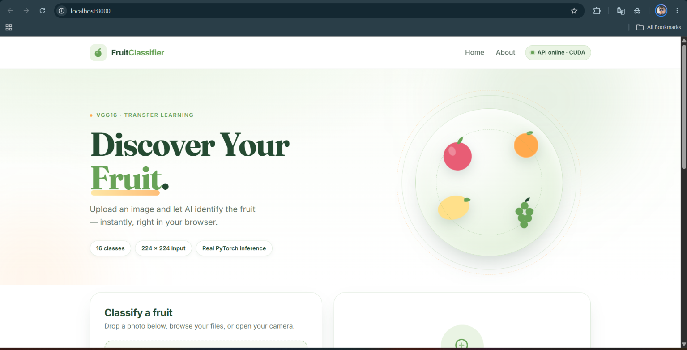
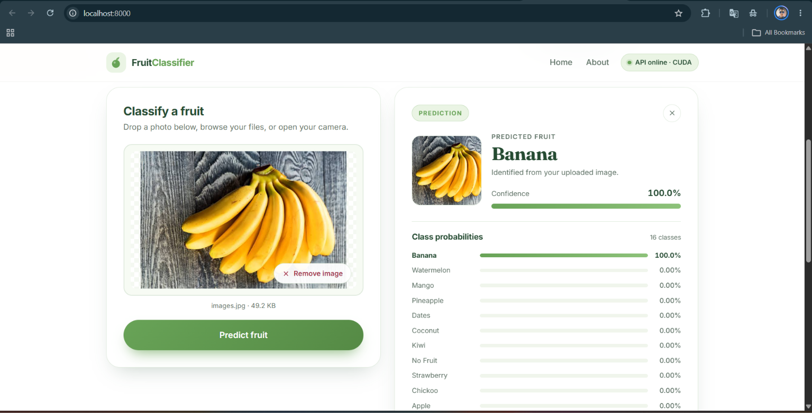
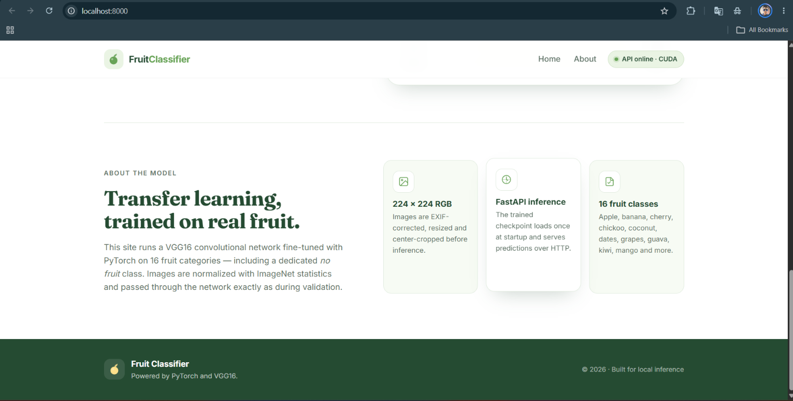

# Fruit Classifier — VGG16 Transfer Learning

A web-based fruit image classification system powered by a fine-tuned VGG16 network. The project combines a PyTorch model, a FastAPI backend, and a responsive HTML/CSS/JavaScript frontend served from a single port.

Upload an image, drag and drop a file, or take a photo with your camera. The application returns the predicted fruit class along with the softmax probabilities for all 16 classes.

> **Local execution only.** This project is not deployed. The application is designed to run on your own machine and is available only at `http://localhost:8000` while the local server is running. It is not publicly accessible.

---

## Project Overview

Fruit Classifier is an end-to-end computer vision project that runs entirely on a local machine. The model is trained in `notebook.ipynb` using transfer learning on VGG16, exported as a PyTorch state dictionary, and served through FastAPI. The frontend calls the API and renders the prediction, confidence score, and complete class-probability breakdown.

The trained checkpoint is loaded once at application startup. Inference uses CUDA when available and falls back to CPU automatically. The project is not hosted anywhere; you run the server locally and open it in your browser.

| Attribute | Detail |
| --- | --- |
| Task | 16-class fruit image classification |
| Model | VGG16 with transfer learning |
| Input | 224 × 224 RGB image |
| Dataset | 3,745 images across 16 classes (kept local, not committed) |
| Test accuracy | 98.13% on 375 held-out images |
| Backend | FastAPI + Uvicorn |
| Frontend | HTML, CSS, vanilla JavaScript |
| Serving | Local only: frontend and API on one origin (`http://localhost:8000`) |
| Model storage | Git LFS (`artifacts/best_fruit_vgg16.pth`) |

---

## Website Demo

Screenshots from the running application at `http://localhost:8000`.

### 1. Homepage and Upload Interface



The landing page introduces the model and presents the classifier card, which supports file browsing, drag and drop, and camera capture.

### 2. Prediction Result



A banana image is classified with its confidence score and the full 16-class probability breakdown rendered as ranked bars.

### 3. About the Model



The About section summarizes the 224 × 224 preprocessing pipeline, FastAPI inference, and the 16 supported fruit classes.

---

## Key Features

- **16-class classification**, including a dedicated `no fruit` class that is displayed as “No Fruit Detected”.
- **Three input methods**: browse files, drag and drop, or capture a still photo with the device camera.
- **Client-side validation** for JPG, PNG, WEBP, BMP, and GIF files up to 10 MB.
- **Detailed prediction output** with the predicted fruit, confidence score, and probabilities for every class.
- **Camera controls** with live preview, capture, retake, and close; camera tracks are released when not in use.
- **Backend status indicator** showing API availability and whether inference is running on CUDA or CPU.
- **Graceful error handling** for invalid files, oversized uploads, camera permission or device errors, and an unreachable backend.
- **Responsive interface** that adapts the classifier, preview, and results for phone, tablet, and desktop widths.
- **Single-origin local serving**: FastAPI serves both the API and the static frontend on `http://localhost:8000`.
- **Efficient inference**: the checkpoint is loaded once, inference is guarded by a lock, and gradients are disabled during prediction.

---

## Supported Fruit Classes

The class order is alphabetical and matches `CLASS_NAMES` in `backend/model.py` exactly.

| # | Class | Dataset folder | Images |
| ---: | --- | --- | ---: |
| 0 | Apple | `apple fruit` | 240 |
| 1 | Banana | `banana fruit` | 240 |
| 2 | Cherry | `cherry fruit` | 240 |
| 3 | Chickoo | `chickoo fruit` | 240 |
| 4 | Coconut | `coconut fruit` | 240 |
| 5 | Dates | `dates fruit` | 240 |
| 6 | Grapes | `grapes fruit` | 240 |
| 7 | Guava | `guava fruit` | 240 |
| 8 | Kiwi | `kiwi fruit` | 240 |
| 9 | Mango | `mango fruit` | 235 |
| 10 | No Fruit | `no fruit` | 150 |
| 11 | Orange | `orange fruit` | 240 |
| 12 | Pineapple | `pineapple fruit` | 240 |
| 13 | Pomegranate | `pomegranate fruit` | 240 |
| 14 | Strawberry | `strawberry fruit` | 240 |
| 15 | Watermelon | `watermelon fruit` | 240 |

The dataset is used only for training and evaluation and is **not** included in the GitHub repository. The trained model is sufficient to run the application.

---

## Model Architecture — VGG16 Transfer Learning

The project uses the torchvision VGG16 architecture with ImageNet-pretrained weights as the starting point.

| Component | Configuration |
| --- | --- |
| Backbone | VGG16 convolutional layers (13 convolutional layers) |
| Pretrained weights | ImageNet (`torchvision.models.VGG16_Weights.DEFAULT`) |
| Frozen layers | Entire VGG16 network frozen before head training |
| Fine-tuned layers | `classifier[3]` and `classifier[6]` weights |
| Adapted classifier | `Linear(4096 → 512)` at `classifier[3]` |
| Output layer | `Linear(512 → 16)` at `classifier[6]` |
| Loss function | Cross-Entropy Loss |
| Optimizer | Adam, learning rate `0.0001` |
| Batch size | 16 |
| Epochs | Up to 50 with early stopping |
| Early stopping | Patience 3, minimum improvement `0.001` |
| Checkpoint | Plain `state_dict` in `artifacts/best_fruit_vgg16.pth` |

During inference, `backend/model.py` rebuilds the same architecture with `weights=None`, loads the checkpoint with `strict=True`, switches the model to evaluation mode, and applies softmax to the 16 output logits. No architecture or preprocessing changes are made between training and serving.

---

## Image Preprocessing

### Training

| Step | Setting |
| --- | --- |
| Random resized crop | 224 × 224, scale `(0.8, 1.0)` |
| Horizontal flip | Random |
| Rotation | Up to 15° |
| Color jitter | Brightness, contrast, and saturation `0.2` |
| Tensor conversion | `ToTensor()` |
| Normalization | ImageNet mean and standard deviation |

### Validation, Testing, and Inference

| Step | Setting |
| --- | --- |
| Resize | Short side to 256 px |
| Center crop | 224 × 224 |
| Tensor conversion | `ToTensor()` |
| Normalization | `mean = [0.485, 0.456, 0.406]`, `std = [0.229, 0.224, 0.225]` |

Uploaded images are verified, EXIF-orientation corrected, and converted to RGB before transformation. This prevents rotated phone photos and non-RGB files from producing incorrect input tensors.

---

## Project Workflow


1. The user selects an image using a file picker, drag and drop, or the camera.
2. The frontend validates the file type and size, then sends it as multipart form data.
3. FastAPI validates the upload, decodes the image with Pillow, and applies the evaluation transform.
4. The VGG16 model produces 16 logits, which are converted to probabilities with softmax.
5. The API returns the top prediction, confidence, and all class probabilities.
6. The frontend renders the result, confidence bar, and sorted probability list.

---

## Technology Stack

| Layer | Technologies |
| --- | --- |
| Deep learning | PyTorch, torchvision |
| Model | VGG16 (ImageNet pretrained, transfer learning) |
| Backend | FastAPI, Uvicorn, python-multipart |
| Image processing | Pillow, NumPy |
| Frontend | HTML5, CSS3, vanilla JavaScript |
| Browser APIs | Fetch API, MediaDevices (`getUserMedia`), Canvas |
| Training and evaluation | scikit-learn, pandas, matplotlib, seaborn, Jupyter |
| Model storage | Git LFS |
| Version control | Git, GitHub |

---

## Project Structure

```text
Fruit-Classifier-VGG16/
│
├── artifacts/
│   └── best_fruit_vgg16.pth
│
├── backend/
│   ├── __pycache__/          # generated locally, ignored by Git
│   ├── main.py
│   └── model.py
│
├── dataset/                  # local only, excluded from Git
│
├── frontend/
│   ├── app.js
│   ├── index.html
│   └── style.css
│
├── website_demo_image/
│   ├── website_demo_1.png
│   ├── website_demo_2.png
│   └── website_demo_3.png
│
├── .gitattributes
├── .gitignore
├── notebook.ipynb
├── README.md
└── requirements.txt
```

- `backend/main.py` defines the FastAPI application, endpoints, validation, and static frontend mount.
- `backend/model.py` contains the VGG16 wrapper, class names, preprocessing, checkpoint loading, and inference logic.
- `frontend/` contains the complete single-page interface.
- `artifacts/best_fruit_vgg16.pth` is stored with Git LFS.
- `dataset/` remains on the local machine and is ignored by Git.

---

## Installation and Setup

### Prerequisites

- **Python 3.12** (the version used to develop and train the project)
- **pip** (installed with Python)
- **Git**
- **Git LFS** (required to download the model checkpoint)
- A CUDA-capable GPU is optional; the application automatically uses the CPU when CUDA is unavailable

Everything runs on your local machine; no external services are needed.

### 1. Clone the repository

```bash
git clone https://github.com/Suryadip92/fruit-classifier-vgg16.git
cd fruit-classifier-vgg16
```

### 2. Download the model checkpoint

The checkpoint is tracked with Git LFS. If Git LFS was not active during cloning:

```bash
git lfs install
git lfs pull
```

Verify that `artifacts/best_fruit_vgg16.pth` is approximately 478 MB, not a small text pointer.

### 3. Create a virtual environment (recommended)

```bash
python -m venv .venv
```

Activate it:

```bash
# Windows
.venv\Scripts\activate

# macOS / Linux
source .venv/bin/activate
```

### 4. Install dependencies

All Python dependencies are declared in the root `requirements.txt`:

```bash
pip install -r requirements.txt
```

### Optional: model path override

The default checkpoint path is `artifacts/best_fruit_vgg16.pth`. To use a different checkpoint, set the `MODEL_PATH` environment variable before starting the server.

### Optional: local dataset for retraining

The repository excludes `dataset/`. To retrain or evaluate the model, place the images under `dataset/image/<class name>/` using the class folder names listed above. The application itself does not require the dataset to run.

---

## Running the Application Locally

The server must be started from the `backend` directory, because the application is imported as `main:app`. Run all commands below from the repository root unless stated otherwise.

### 1. Start the FastAPI server

```bash
cd backend
python -m uvicorn main:app --host 127.0.0.1 --port 8000
```

The first startup takes a few seconds while the VGG16 checkpoint (approximately 478 MB) is loaded into memory. Wait until the terminal reports that the model has loaded before opening the website.

### 2. Open the website

Once the server is running, open the following URL in your browser:

**[http://localhost:8000](http://localhost:8000)**

This is the exact local address of the application. The same FastAPI server delivers both the website and the API, so no separate frontend server is needed.

### 3. Open the API documentation

FastAPI generates interactive Swagger documentation automatically:

**[http://localhost:8000/docs](http://localhost:8000/docs)**

You can use the Swagger UI to inspect the endpoints and test `POST /predict` directly by uploading an image from your machine.

Additional local endpoints:

- Health check: [http://localhost:8000/health](http://localhost:8000/health)
- Service metadata: [http://localhost:8000/status](http://localhost:8000/status)

### Stopping the server

Press `Ctrl+C` in the terminal where the server is running. The application stops and the local URLs above become unavailable until you start the server again.

> The application runs only on your machine and is intended for local use. The project is not deployed, and the local URLs above are available only while the server is running.

---

## API Endpoints

| Method | Path | Description |
| --- | --- | --- |
| `GET` | `/` | Serves the frontend (`index.html`) |
| `GET` | `/status` | Service metadata and available endpoints |
| `GET` | `/health` | Model status, checkpoint name, device, image size, and class list |
| `POST` | `/predict` | Accepts an image and returns the prediction and probabilities |
| `GET` | `/docs` | Interactive Swagger UI documentation |

### `POST /predict`

Send a multipart form request with the image in the `file` field:

```bash
curl -X POST http://localhost:8000/predict -F "file=@fruit.jpg"
```

Accepted content types: JPEG, PNG, WEBP, BMP, and GIF. Maximum file size: 10 MB.

Response fields:

| Field | Type | Description |
| --- | --- | --- |
| `success` | boolean | `true` when inference succeeds |
| `filename` | string | Original uploaded filename |
| `predicted_class` | string | Internal class label, such as `banana fruit` |
| `display_name` | string | UI-friendly label, or `No Fruit Detected` |
| `class_index` | integer | Class index from 0 to 15 |
| `confidence` | float | Top softmax probability, rounded to six decimals |
| `probabilities` | object | All 16 class labels mapped to probabilities, sorted in descending order |

Common error responses:

| Status | Meaning |
| --- | --- |
| `400` | Empty file, unsupported type, or invalid image |
| `413` | Image larger than 10 MB |
| `503` | Model has not finished loading |
| `500` | Unexpected inference failure |

---

## Model Performance

Metrics below are taken from the evaluation outputs in `notebook.ipynb` on the held-out test split.

| Metric | Value |
| --- | ---: |
| Test accuracy | **98.13%** |
| Test loss | 0.0479 |
| Macro precision | 98.25% |
| Macro recall | 97.86% |
| Macro F1-score | 97.98% |
| Weighted precision | 98.21% |
| Weighted recall | 98.13% |
| Weighted F1-score | 98.11% |
| Best validation accuracy | 99.20% (epoch 26) |
| Early stopping | Epoch 27 of 50 |

Dataset and split details:

| Item | Value |
| --- | ---: |
| Total images | 3,745 |
| Training images | 2,996 (80%) |
| Validation images | 374 (10%) |
| Test images | 375 (10%) |
| Corrupted images found | 0 |
| Split strategy | Stratified, random seed 42 |

The best checkpoint was selected by validation loss. These figures are reported exactly as produced by the notebook; results may vary if the model is retrained.

---

## Future Improvements

- Expand the dataset with more fruit varieties, lighting conditions, and backgrounds to improve generalization.
- Add Grad-CAM or similar visual explanations to show which image regions influenced a prediction.
- Export the model to ONNX or TorchScript and evaluate quantization for faster CPU inference.
- Add automated backend and browser tests to a continuous integration workflow.
- Containerize the application with Docker for reproducible local environments.
- Add prediction history or batch image uploads for larger evaluation workflows.
- Support continuous camera classification; the current camera flow captures a single still frame.

---

## Author and GitHub Repository

**Author:** [@Suryadip92](https://github.com/Suryadip92)

**Repository:** [Suryadip92/fruit-classifier-vgg16](https://github.com/Suryadip92/fruit-classifier-vgg16)

If you find this project useful, consider starring the repository.
